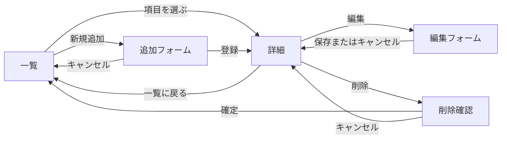

# レポート用Webアプリの設計

一覧から1件を選んで詳細を確認できるWebアプリを3つ作る。各アプリでデータの追加・変更・削除ができるようにする。

## 対象とデータ項目

### 1. Mrs. GREEN APPLEの曲リスト

曲名や聴きたい場面を見ながら、そのときの気分に合う曲を探す。既存の `/songs` の曲リストを使う。

| 項目名 | 型 | 内容 |
| --- | --- | --- |
| `id` | 整数 | 曲のID。登録時に自動採番する |
| `title` | 文字列 | 曲名。必須 |
| `scene` | 文字列 | 聴きたい場面。必須 |
| `note` | 文字列 | おすすめの理由や好きなところ。任意 |

一覧には曲名と聴きたい場面を表示し、詳細にはメモも表示する。

### 2. 映画鑑賞メモ

観た映画を記録し、評価や感想を振り返る。

| 項目名 | 型 | 内容 |
| --- | --- | --- |
| `id` | 整数 | 映画のID。登録時に自動採番する |
| `title` | 文字列 | 作品名。必須 |
| `watchedOn` | 文字列 | 鑑賞日（YYYY-MM-DD）。必須 |
| `rating` | 整数 | 評価（1〜5）。必須 |
| `review` | 文字列 | 感想。任意 |

一覧には作品名・鑑賞日・評価を表示し、詳細には感想も表示する。

### 3. 料理レシピ帳

よく作る料理を登録し、必要な材料と作り方を確認する。

| 項目名 | 型 | 内容 |
| --- | --- | --- |
| `id` | 整数 | レシピのID。登録時に自動採番する |
| `name` | 文字列 | 料理名。必須 |
| `minutes` | 整数 | 調理時間（分、1以上）。必須 |
| `ingredients` | 文字列 | 材料と分量。必須 |
| `steps` | 文字列 | 作り方。必須 |

一覧には料理名と調理時間を表示し、詳細には材料と作り方も表示する。

## ページ遷移

3つのアプリに同じ操作の流れを使う。一覧のURLは曲が `/songs`、映画が `/movies`、レシピが `/recipes`。

## URLと処理

`{base}` は各アプリの一覧URL、`:id` はデータのIDを表す。

| メソッド | URL | 処理 |
| --- | --- | --- |
| GET | `{base}` | 一覧を表示する |
| GET | `{base}/:id` | 指定されたデータの詳細を表示する |
| GET | `{base}/new` | 追加フォームを表示する |
| POST | `{base}` | データを追加し、追加したデータの詳細へ移動する |
| GET | `{base}/:id/edit` | 現在の値を入れた編集フォームを表示する |
| POST | `{base}/:id/edit` | データを変更し、詳細へ戻る |
| GET | `{base}/:id/delete` | 削除するデータを表示し、確認を求める |
| POST | `{base}/:id/delete` | データを削除し、一覧へ戻る |

## 共通仕様

- ExpressでURLごとの処理を定義し、EJSで画面を表示する。
- データはアプリごとにJavaScriptの配列で管理する。サーバーを再起動すると初期データに戻る。
- IDは各アプリで1から順に採番する。削除後も同じIDを再利用しない。
- フォームの入力に誤りがある場合は、入力値とエラーメッセージを表示する。存在しないIDへのアクセスには404を返す。
