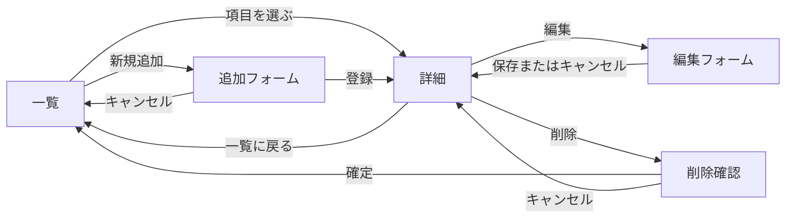

# レポート用Webアプリの設計

一覧から1件を選んで詳細を確認できるWebアプリを3つ作る。各アプリでデータの追加・変更・削除ができるようにする。

## 対象とデータ項目

### 1. Mrs. GREEN APPLEの曲リスト

曲名や聴きたい場面を見ながら、そのときの気分に合う曲を探す。既存の `/songs` の曲リストを使う。

| 項目名 | 型 | 内容 |
| --- | --- | --- |
| `id` | 整数 | 曲のID。登録時に自動採番する |
| `title` | 文字列 | 曲名。必須 |
| `scene` | 文字列 | 聴きたい場面。必須 |
| `note` | 文字列 | おすすめの理由や好きなところ。任意 |

一覧には曲名と聴きたい場面を表示し、詳細にはメモも表示する。

### 2. ディズニーのアトラクション一覧

アトラクションのタイプや利用条件を調べ、乗りたいアトラクションを探す。

| 項目名 | 型 | 内容 |
| --- | --- | --- |
| `id` | 整数 | アトラクションのID。登録時に自動採番する |
| `name` | 文字列 | アトラクション名。必須 |
| `capacity` | 整数 | 1台または1回あたりに乗車・入場できる人数（人、1以上）。必須 |
| `openedOn` | 文字列 | アトラクションの開業日（YYYY-MM-DD）。必須 |
| `type` | 文字列 | アトラクションのタイプ（ライド、シアターなど）。必須 |
| `requirements` | 文字列 | 利用条件（最低身長、同伴者の要否など）。条件がない場合は「なし」と記録する |

一覧にはID・アトラクション名・タイプを表示し、詳細には収容人数・開業日・利用条件も表示する。

### 3. サッカー日本代表の選手一覧

日本代表選手のプロフィールを調べ、ポジションやプレースタイルを確認する。

| 項目名 | 型 | 内容 |
| --- | --- | --- |
| `id` | 整数 | 選手のID。登録時に自動採番する |
| `name` | 文字列 | 選手名。必須 |
| `birthDate` | 文字列 | 生年月日（YYYY-MM-DD）。必須 |
| `position` | 文字列 | 主なポジション（GK・DF・MF・FW）。必須 |
| `club` | 文字列 | 所属クラブ名。必須 |
| `characteristics` | 文字列 | 選手の特徴（得意なプレーやプレースタイルなど）。必須 |

一覧にはID・選手名・ポジション・所属クラブを表示し、詳細には生年月日・選手の特徴も表示する。

## ページ遷移

3つのアプリに同じ操作の流れを使う。一覧のURLは曲が `/songs`、アトラクションが `/attractions`、日本代表選手が `/players`。

## URLと処理

`{base}` は各アプリの一覧URL、`:id` はデータのIDを表す。

| メソッド | URL | 処理 |
| --- | --- | --- |
| GET | `{base}` | 一覧を表示する |
| GET | `{base}/:id` | 指定されたデータの詳細を表示する |
| GET | `{base}/new` | 追加フォームを表示する |
| POST | `{base}` | データを追加し、追加したデータの詳細へ移動する |
| GET | `{base}/:id/edit` | 現在の値を入れた編集フォームを表示する |
| POST | `{base}/:id/edit` | データを変更し、詳細へ戻る |
| GET | `{base}/:id/delete` | 削除するデータを表示し、確認を求める |
| POST | `{base}/:id/delete` | データを削除し、一覧へ戻る |

## 共通仕様

- ExpressでURLごとの処理を定義し、EJSで画面を表示する。
- データはアプリごとにJavaScriptの配列で管理する。サーバーを再起動すると初期データに戻る。
- IDは各アプリで1から順に採番する。削除後も同じIDを再利用しない。
- フォームの入力に誤りがある場合は、入力値とエラーメッセージを表示する。存在しないIDへのアクセスには404を返す。
